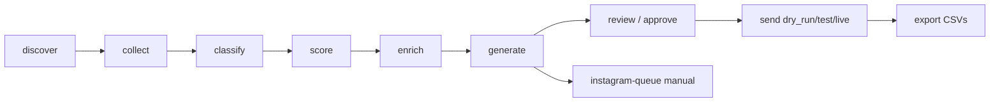

# CreatorReach AI

Python CLI that discovers technology and AI micro-influencers on YouTube, scores public fit, enriches publicly listed contacts, drafts grounded outreach, and routes sends through human approval. Dry-run is the default.

See [docs/PROJECT_SPEC.md](docs/PROJECT_SPEC.md) for the full assignment specification.

## Architecture



Package layout:

- `outreach/providers/` — YouTube, LLM, DryRun/Gmail senders
- `outreach/services/` — quota, cache, discovery, engagement, scoring, enrichment, approval, outreach
- `outreach/prompts/` — classification, ranking, email, DM prompts
- `tests/fixtures/` — synthetic fixtures only

## Setup

```bash
python -m venv .venv
source .venv/bin/activate
pip install -r requirements.txt
# optional LLM:
pip install anthropic>=0.40
cp .env.example .env
# edit config.yaml brand block and queries
python -m outreach.cli init-db
python -m unittest discover -s tests -t .
```

Python 3.11+ recommended.

## Environment variables

| Variable | Role |
|---|---|
| `YOUTUBE_API_KEY` | Required for live discovery/collect |
| `ANTHROPIC_API_KEY` | Optional; offline fallback used when missing |
| `ANTHROPIC_MODEL` | Default `claude-sonnet-4-5` |
| `OUTREACH_MODE` | `dry_run` (default), `test`, or `live` |
| `SEND_TEST_EMAIL_TO` | Required when mode is `test` |
| `GMAIL_CREDENTIALS_FILE` | OAuth client JSON; required for `live` |
| `GMAIL_TOKEN_FILE` | OAuth token path; required for `live` |

Optional overrides: `OUTREACH_DB_PATH`, `OUTREACH_EXPORT_DIR`, `MIN_FOLLOWERS`, `MAX_FOLLOWERS`, `PAGES_PER_QUERY`, `RECENT_UPLOAD_DAYS`, `MIN_ENGAGEMENT_RATE`, `QUOTA_*`, `CACHE_TTL_DAYS`.

Secrets belong in `.env`, never in `config.yaml`. Logs redact API-key and token shapes.

## YouTube API setup

1. Google Cloud Console → enable **YouTube Data API v3**
2. Create an API key → set `YOUTUBE_API_KEY`
3. Keep daily quota in mind (default 10,000 units)

## Discovery methodology

Queries from `config.yaml` → `search.list` (`type=channel`) → dedupe by channel ID → batched `channels.list` (≤50 IDs) → store every candidate → later stages filter.

Recent videos come from the channel uploads playlist (`playlistItems.list` + `videos.list`). **Never** `search.list` per channel for uploads.

Discovery and collect are idempotent and resumable.

## Quota and cache

Configured costs (also printed by `quota`):

| Endpoint | Units |
|---|---|
| search.list (per page) | 100 |
| channels.list | 1 |
| playlistItems.list | 1 |
| videos.list | 1 |

- Daily budget 10,000; safety budget 9,000; search calls/day 100
- Successful responses cached in SQLite with configurable TTL (default 7 days)
- Cache hits do **not** reserve quota
- Uncached calls reserve quota first and stop at the safety budget
- Search pages are explicit and each page is budgeted
- Retries only for 429 / 5xx; never for quotaExceeded, auth, invalid, forbidden, not-found
- Quota events and search-call counts are stored in SQLite

## Database tables

`schema_migrations`, `discovery_runs`, `influencers`, `content_items`, `messages`, `outreach`, `field_provenance`, `api_cache`, `quota_events`, `suppression_list`, `instagram_dm_queue`

Influencers are unique on `(platform, external_id)`. Outreach is append-only with a unique `idempotency_key` and partial unique indexes preventing multiple successful email sends per influencer and per normalized email.

## Normalized creator fields

Stored columns include: `id`, `platform`, `external_id`, `name`, `handle`, `profile_url`, `description`, `followers`, `followers_source` (`api_reported`), `uploads_playlist_id`, niche/theme fields, engagement fields, `contact_email` / `email_status` / `email_source_url`, `website`, `instagram_url`, audience fields defaulting to `Not Found`, `creator_country`, fit/qualification fields, timestamps, `last_error`.

## Filtering and fit score

Hard gates → `FAIL` with reason:

- hidden/missing subscribers
- outside 5,000–100,000 (configurable)
- no public videos
- no upload within `recent_upload_days`
- engagement below `minimum_engagement_rate`

Otherwise 100-point score: audience 20, niche 25, content 20, engagement 20, activity 10, geography 5.

**Email availability never affects `fit_score`.** It only sets `contactable`.

Niche matching uses word/phrase boundaries (not `"ai" in text`).

## Engagement

Latest ≤10 public videos; exclude zero/missing views and hidden likes:

`(avg likes + avg comments) / avg views * 100`

Stored with sample size, method, and timestamp. Labeled as an independently calculated public estimate — not YouTube Analytics.

## Public enrichment

Only `PASS` / `REVIEW` creators. Emails from channel description then linked public site (`/`, `/contact`, `/about`). Robots.txt, timeouts, size caps, HTTP(S) only, block localhost/private IPs. No form submission. Reject asset-like emails (`x@2x.png`). Missing fields → `Not Found`. No demographic invention. Instagram/TikTok URLs recorded only when publicly linked — never scraped.

## LLM

Three structured tasks (classification, fit explanation, email/DM) with JSON + Pydantic validation, prompt versions under `outreach/prompts/`, up to 3 retries with the validation error, then **offline-fallback**. Anthropic is optional. Deterministic fit score is never overwritten by the LLM.

Email body 60–90 words; DM 15–30 words; no unresolved placeholders; content references must appear in supplied themes/titles.

## Approval

Messages start as `PENDING_REVIEW`. Approval requires valid public email, valid message, no placeholders, no suppression match, non-stale profile, no prior successful outreach, and an explicit reviewer. **Approval does not send.**

```bash
python -m outreach.cli review
python -m outreach.cli approve --message-id ID --reviewer NAME
python -m outreach.cli reject --message-id ID --reason REASON
```

## Sending

```bash
python -m outreach.cli send --message-id ID --mode dry_run
python -m outreach.cli send --message-id ID --mode test --confirm
python -m outreach.cli send --message-id ID --mode live --confirm
```

- `dry_run` (default): never constructs Gmail; records `SIMULATED`
- `test`: redirects to `SEND_TEST_EMAIL_TO`; logs intended recipient
- `live`: Gmail API `messages.send` with `gmail.send` scope; requires credentials + `--confirm`

Duplicate prevention: Python checks by influencer and normalized email + deterministic idempotency key + SQLite unique/partial unique indexes.

## Instagram manual queue

Never auto-sends DMs. Export/list:

```bash
python -m outreach.cli instagram-queue
python -m outreach.cli instagram-mark-sent --queue-id ID
```

CSV: `data/instagram_dm_queue.csv`

## CLI examples

```bash
python -m outreach.cli init-db
python -m outreach.cli discover
python -m outreach.cli collect
python -m outreach.cli classify
python -m outreach.cli score
python -m outreach.cli enrich
python -m outreach.cli generate
python -m outreach.cli review
python -m outreach.cli approve --message-id 1 --reviewer alex
python -m outreach.cli send --message-id 1 --mode dry_run
python -m outreach.cli export
python -m outreach.cli status
python -m outreach.cli quota
python -m outreach.cli run   # discover→…→generate→export; never approves/sends
```

## Outputs (`data/`)

- `influencers.csv`
- `personalized_messages.csv`
- `outreach_tracker.csv`
- `outreach_log.csv`
- `instagram_dm_queue.csv`
- `outreach.db`

Production exports never include synthetic fixtures from `tests/fixtures/`.

## Tests

```bash
python -m unittest discover -s tests -t .
```

All network calls are mocked. Coverage includes normalization, dedupe, quota reservation, cache hits, pagination budgeting, error classification, engagement, word-boundary niche matching, hard gates, fit scoring, email extraction, message validation, approval blocking, dry-run not calling Gmail, duplicate prevention, and CSV export.

## Security and data provenance

- No fabricated influencer records
- No guessed emails
- No Instagram/TikTok scraping
- No automated Instagram DMs
- Dry-run default; Gmail live sending optional for demos
- Audience demographics are `Not Found` when unavailable
- Subscriber counts labeled API-reported
- Engagement labeled independently calculated
- Field provenance and retrieval timestamps stored
- API keys / OAuth tokens excluded from logs and git (`.gitignore`)

## Limitations

- Only a fraction of channels publish an email publicly
- Engagement is approximate; subscriber counts may be rounded by YouTube
- YouTube only for automated discovery
- Brand block in `config.yaml` is a placeholder
- Cold-email laws (CAN-SPAM/GDPR) and platform ToS apply to real campaigns

## Compliance notes

Use human approval before any live send. Prefer test-mode redirects during demos. Respect creator opt-outs via the suppression list. Do not bypass YouTube’s private “View email address” controls.
